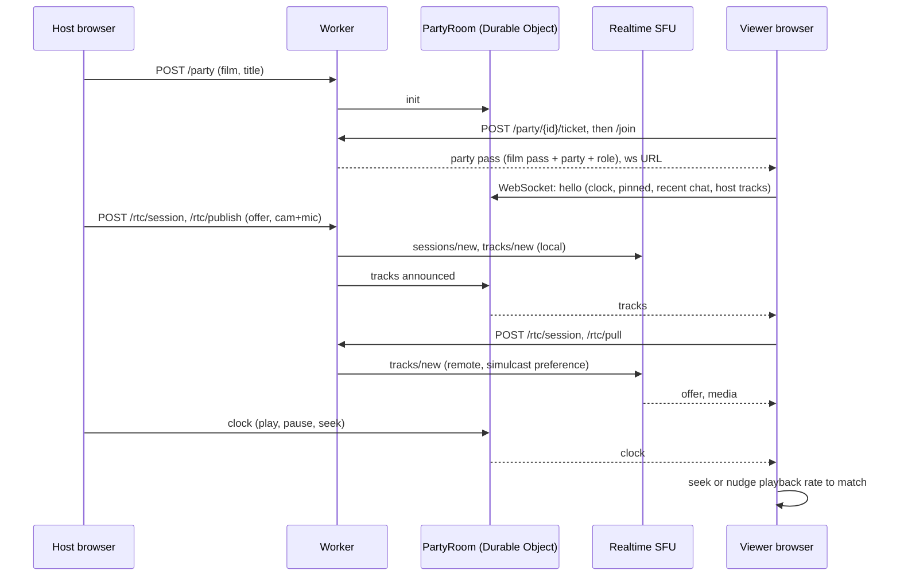

# Ztor watch party: architecture and pricing

Date: 2026-09-25. Scope: the watch party feature built 2026-09-24 to 2026-09-25 on the Ztor 5B platform (Cloudflare Free plan plus an Axinom DRM trial). Companion documents: `BUILD_REPORT.md` sections 8 to 12 (measurements and decisions in date order), `BUILD_PLAN.md` (progress log), the user guide (Claude doc "Ztor User Guide").

## 1. Summary

- **What it is.** One host plays a film; viewers watch the same film in sync, see and hear the host through a small camera tile, and chat. Viewers enter with a **ticket** that is valid for one party only; a film rental is a separate product and does not open a party.
- **What it runs on.** Cloudflare only: Workers, D1, Durable Objects, R2 and Realtime SFU. No LiveKit, no Cloudflare Stream, no RealtimeKit.
- **Cost.** $0 so far. A party of a hundred viewers costs nothing on top of the film. A thousand-viewer party costs about $20 to $60 a month of Realtime egress plus the $5 Workers Paid plan, against about $500 a month on LiveKit Cloud for the same audience.
- **Design choice that sets the cost.** The film never travels through WebRTC. Each viewer streams it from R2 with their own signed pass, and the host only broadcasts a clock. Only the host's camera and microphone go through the SFU, at 0.7 to 1.2 Mbps per viewer instead of the 5 to 8 Mbps the film would take.

## 2. Architecture

### 2.1 Components

| Component | Cloudflare service | What it holds or does | Code |
|---|---|---|---|
| API and pages | Worker `ztor-video` | routes for accounts, films, rentals, tickets, parties, WebRTC signalling; serves `/app` | `src/index.ts`, `src/app-routes.ts`, `src/party-routes.ts`, `src/auth.ts` |
| Party room | Durable Object `PartyRoom`, one per party (SQLite class) | roster, chat, pinned message, slow mode, mute and ban lists, the host's playback clock, the list of the host's live SFU tracks; WebSocket to every viewer with the Hibernation API | `src/party.ts` |
| Records | D1 `ztor-video` | users, sessions, films, rentals, parties, party_tickets, party_members, party_messages (chat archive), party_actions | `migrations/0005` to `0007` |
| Film delivery | R2 `ztor-streams` through the Worker | the film's protected-URL version: clear HLS and DASH segments, every link signed with the viewer's pass | existing Phase A media route |
| Host audio and video | Realtime SFU app (WebRTC) | the host publishes camera plus mic, or mic only; each viewer pulls the tracks; three simulcast layers | `src/sfu.ts`, `public/app.html` |
| Relay for strict NATs | Realtime TURN | wired, no key created yet (STUN only today) | `src/sfu.ts` |
| Page | `public/app.html` at `/app` | one file: sign in, Home, Watch, Party, Admin | |

### 2.2 How a party flows

Reading it: the Worker owns every credential, the room owns every piece of shared state, the SFU only forwards media, and the film itself goes straight from R2 to each viewer through the existing media route.

### 2.3 Rights: rental versus ticket

| Right | Grants | Checked by |
|---|---|---|
| Rental (48 h) | the film on the Watch page, DRM or protected-URL version, up to 4K | `/play` |
| Ticket | one party: the film inside that party, in sync, while it runs; capped at 1080p (protected-URL version) | `/party/{id}/join`; the pass it yields is bound to the party and the film; `/play` still refuses a ticket holder without a rental |
| Host | rents the film to screen it; needs no ticket | `/party` create and join |

The party pass is a JSON Web Token: the viewer's id, the film id, `mode: url`, the party id, the role and the display name, 4 hours. The media route accepts it for that film's protected-URL files only; the room accepts it for that party only.

### 2.4 Roles

| Role | Can do |
|---|---|
| user | rent, watch, get tickets, join parties, chat |
| host | everything a user can, plus create and run parties (camera, mic, pin, mute, remove, slow mode, end) |
| admin | everything a host can, plus the Admin screen (change roles; the last admin cannot demote themselves) |

Accounts: email and password, PBKDF2-SHA256 at 100,000 iterations, HttpOnly session cookie, 30 days, sessions in D1. The first account ever registered is the admin.

### 2.5 The pieces that took the most work

- **One SFU session per publish group.** Closing tracks by renegotiating a live PeerConnection fails in Chrome ("RTP extension ID reassignment not supported"): the SFU's answer renumbers header extensions on the now-inactive media line. So the host's camera plus mic is one session and the mic-only mode is another; stopping a group closes its connection, restarting opens a fresh one, and viewers open one connection per host session. Nothing is renegotiated on a live connection except the SFU's own first offer to a viewer.
- **Pull retries.** The room announces tracks as soon as the publish call returns; a viewer pulling within the next second gets `empty_track_error`. Viewers retry with backoff (0.8, 1.5, 2.2 s and so on).
- **Simulcast.** The host sends three layers of every video track (full, half and quarter size; 1.2, 0.4 and 0.15 Mbps for the camera). Viewers ask for the top layer with `priorityOrdering: asciibetical`, so the SFU steps them down when their bandwidth is short; a viewer loop steps down after more than 5 percent packet loss and back up after 30 clean seconds through `PUT /party/{id}/rtc/layer`. Down-switches show within 7 s, up-switches in 10 to 20 s.
- **Sync.** The clock is `{state, position, rate, at}` stamped with the room's time. Viewers keep an NTP-style offset from three round trips, seek when more than 2 s off and otherwise nudge playback rate by 5 percent. Measured drift while playing: within 0.2 s.
- **Host disconnect.** When no host socket is connected, the room retracts the host's tracks so viewers drop the dead sessions; the SFU collects them after 30 s of silence.
- **Chat archive.** Messages and host actions are written to D1 in one batch per 3-second tick, not per message.

### 2.6 Measured (headless Chrome 153 on a Mac, fake camera, real SFU)

| Item | Result |
|---|---|
| Host camera 1280x720 at 19 fps, egress per viewer | 0.7 Mbps measured, 1.2 Mbps cap |
| Camera tile at a viewer after publish | about 1 s |
| Film sync while playing | -0.06 to +0.17 s |
| Camera stop, restart, mic only, host page reload, late joiner | all pass |
| Security checks (join without ticket, viewer clock, viewer publish, ticket on another film, chat burst, kicked rejoin) | 6 of 6 pass |
| Realtime meter for all test parties | 0.06 GB egress, $0 |

## 3. Pricing

### 3.1 Price list of the services used

| Service | Free allowance | Beyond it | Notes |
|---|---|---|---|
| Workers | 100,000 requests per day | Workers Paid $5 per month, then $0.30 per million | Free plan stops serving at the cap; it never bills |
| Durable Objects | 100,000 requests per day, 13,000 GB-s per day, 5 GB | included in Workers Paid | incoming WebSocket messages count 20 to 1 |
| D1 | 5 M rows read and 100k rows written per day, 5 GB | included in Workers Paid | |
| R2 | 10 GB stored, 1 M class A and 10 M class B operations per month, egress free | $0.015 per GB stored | the only service that bills on the Free plan |
| Realtime SFU and TURN | 1,000 GB egress per month, shared | $0.05 per GB | no per-participant fee, no concurrency tier |
| RealtimeKit (not used) | free in beta, none after | $0.002 per participant-minute | rejected: bills every viewer per minute |
| Cloudflare Stream (not used) | none | $1 per 1,000 minutes delivered plus storage | only needed for recording or HLS output to people outside the room |

### 3.2 What a party costs

Host camera at the measured 0.7 Mbps is 0.32 GB per viewer-hour; at the 1.2 Mbps cap, 0.54 GB. The film's own delivery is R2 egress, which is free, plus about 1,200 Worker requests per hour watched.

| Scenario per month | Realtime egress | Realtime cost | Workers | Total on Cloudflare |
|---|---|---|---|---|
| One party, 100 viewers, 1 hour | 32 to 54 GB | $0 | Free plan | **$0** |
| Four parties, 100 viewers, 1 hour each | 130 to 220 GB | $0 | Free plan | **$0** |
| Four parties, 1,000 viewers, 1 hour each | 1.3 to 2.2 TB | $14 to $58 | Workers Paid, $5, because the film segments exceed 100,000 requests a day | **$19 to $63** |
| Each further 1,000 viewer-hours beyond the free terabyte | 0.32 to 0.54 TB | $16 to $27 | | |

Had the film been pushed through the SFU instead, a 1080p viewer would cost about 2.6 GB per hour: a thousand-viewer hour would be 2.6 TB, about $80. That is why the film goes from R2 and only the host's tracks go through WebRTC.

### 3.3 Against LiveKit Cloud

| | Cloudflare (this build) | LiveKit Cloud |
|---|---|---|
| Monthly fee | $0; $5 Workers Paid at scale | Build $0, Ship $50, Scale $500 |
| Per participant | none | 5,000 minutes on Build; 150,000 on Ship then $0.0005 per minute; 1.5 M on Scale then $0.0004 |
| Downstream bandwidth | 1,000 GB free, then $0.05 per GB | 50 GB on Build; 250 GB on Ship then $0.12 per GB; 3 TB on Scale then $0.10 |
| Concurrent connections | no published cap | 100 on Build, 1,000 on Ship, 5,000 on Scale |
| Room state, chat archive | Durable Object and D1, inside the free tier | not included; needs your own backend |
| Simulcast | supported; layer switching is your code (built) | automatic in the SDK |

| Scenario per month | Cloudflare | LiveKit |
|---|---|---|
| One party, 100 viewers, 1 hour | $0 | $50 (6,060 participant-minutes, over Build's 5,000) |
| Four parties, 100 viewers | $0 | $50 |
| Four parties, 1,000 viewers | $19 to $63 | $500 (host plus viewers exceed Ship's 1,000 connections) |
| Each further 1,000 viewer-hours | $16 to $27 | $56 to $95 |

RealtimeKit, Cloudflare's LiveKit-like SDK, would have been priced like LiveKit: $12 per 100-viewer hour and $120 per 1,000-viewer hour.

### 3.4 Account meters as of 2026-09-25

| Meter | Used this month | Free allowance |
|---|---|---|
| Workers requests | 18,110 | 100,000 per day |
| Durable Object requests | 1,630 | 100,000 per day |
| D1 rows read and written | 279k and 3.4k | 5 M and 100k per day |
| R2 storage | 8.20 GB (streams 4.36, masters 3.85) | 10 GB, the only meter near its cap |
| Realtime SFU egress | 0.06 GB | 1,000 GB per month |
| Billed | $0 | |

## 4. Limits and what changes at scale

| Audience | What changes | Cost |
|---|---|---|
| tens | nothing | $0 |
| hundreds | nothing on the party side; the film segments approach the Free plan's 100,000 requests a day at about 80 full film views a day | $0 until the cap, then Workers Paid $5 |
| thousands | Workers Paid for the film segments; a custom domain with a cache rule that ignores the pass token so segments come from cache; a TURN key so viewers behind strict NATs connect | $5 per month plus a domain; TURN shares the free terabyte |
| tens of thousands | HLS output to people outside the WebRTC room becomes cheaper than one WebRTC session each | Stream Live, $1 per 1,000 minutes |

## 5. Not built

| Item | Why | Cost to do |
|---|---|---|
| Ticket price and payment | no payment step in the product yet; the tickets table has price columns | a payment provider |
| Recording, replay, HLS output | would need Stream Live; not asked for | $1 per 1,000 minutes delivered |
| TURN key | not needed on the networks tested | $0, dashboard |
| Screen share | removed on request | |
| Password reset, email verification | needs an email sender | a mail API |
| Safari and iOS verification of the party page | only Chrome was driven headless; Safari FairPlay works on the Watch page | devices and time |

## 6. Sync fix (added 2026-10-01)

Reported from a real test: the host's and the viewer's picture were 1 to 2 s apart, and since the host pauses on a frame to ask questions about the scene, the frames must match.

**Why it happened.** The "sync" figure on the viewer page compared the viewer with the clock, not with the host's picture, and four things sat between the two: the room stamped the host's clock on arrival, so every viewer trailed by the host's uplink latency; the host reported on `play` (before its picture moved) and then only every 5 s; viewers checked every 0.5 s, ignored errors under 0.3 s, and corrected at 5 percent speed; and a paused viewer only jumped to the host's frame when more than 0.5 s off.

**What changed** (`public/app.html`, `src/party.ts`; nothing in the SFU, chat or tickets):

| | Before | After |
|---|---|---|
| Clock timestamp | room's arrival time | the host's own room-time stamp (same offset viewers use); the room accepts it within 3 s of its clock |
| Host reports | `play`, `pause`, `seeked`, every 5 s | also `playing` and `waiting` (a frozen host picture counts as paused), every 1 s while playing |
| Viewer check | every 0.5 s | on every clock message and every 0.25 s |
| Paused | seek only if > 0.5 s off | always seek to the host's frame (threshold one frame, once per clock) |
| Playing | dead band 0.3 s, 5 percent nudge, seek above 2 s | dead band one frame (0.04 s), proportional up to 10 percent (Chrome keeps the pitch), seek above 1 s with 2.5 s between seeks |
| Room-time offset | last of 3 pings at connect | lowest-latency of 3 pings, repeated every 30 s |
| Room storage | one write per clock | state changes, seeks and a 5 s heartbeat only, so the 1 s reports do not add D1-style row writes |

**Measured** (headless Chrome, host and viewer pages on one machine sampled at the same instant, 300 ms of emulated network latency on both, the 73 s SPL2 trailer; viewer minus host, in seconds):

| Phase | Before | After (new page, old room) |
|---|---|---|
| Playing, first 30 s, 2 s samples | -1.64 to -0.38, mean -0.83 after 10 s | -0.03 to -0.04 |
| Host pauses, 2 s and 4 s later | -0.11 (viewer stays on a different frame) | 0.00 |
| Host resumes | -0.27 | -0.06 |
| Host seeks while playing | +0.10 | -0.05 |
| Host seeks then pauses | 0.00 | 0.00 |

The "after" column was measured with the new page against the room code that was still deployed, which ignores the host's stamp, so the small remaining lag while playing is the uplink latency the deployed room removes. On the real network the host's phone adds its own camera and WebRTC delay to its voice, about 0.3 to 0.5 s, which is separate from the film clock and unchanged.

### 6.1 Voice alignment (added 2026-10-01, later the same day)

With the film frames matched, the next question was the host's voice: it travels through the SFU and arrives 0.3 s or more after the film clock, so "look at this" was heard after the frame appeared. Fix chosen by the user: each viewer delays its film by the measured voice delay, so the frame the host is talking about appears as the words arrive.

- **How the delay is measured** (`public/app.html`): half the host's WebRTC round trip to the SFU (the host sends it with every clock; `src/party.ts` stores it as `clock.rtt`), plus half the viewer's own round trip, plus the viewer's audio jitter buffer from the inbound audio statistics, plus 80 ms for encoding, decoding and the SFU. Measured every 2 s, smoothed 70/30, capped at 2 s, held at the last known round trip when a statistics sample has none, and 0 when no host audio is being received (camera and mic off).
- **How it is applied**: the viewer replays the host's timeline that much later. Each clock is held from its local arrival for the voice delay minus the time it already spent in transit, never longer than the voice delay, so a wrong time-offset estimate cannot hold a pause back. Paused clocks still land on the host's exact frame, just later, which is when the host's words about it arrive.
- **What a viewer sees**: the "clock" field shows `voice +0.xx s`, and the Details log prints the components every 10 s.

Measured (same harness, host camera and mic on, 300 ms emulated latency; the emulation also stretches the WebRTC round trips to about 625 ms each way, so the numbers are a worst case):

| Phase | Viewer minus host, film | Viewer's voice delay estimate |
|---|---|---|
| Playing (live, version c9909493) | -0.81 to -0.88 s | 0.90 s |
| Host pauses | +0.02 s, same frame | |
| Host resumes, seeks | -0.89 to -0.93 s | 0.90 s |
| Delay components in the log | host round trip 634 ms, viewer round trip 630 ms, jitter buffer 152 ms | 864 ms |
| Camera off, mic-only republished | delay drops to 0 then rebuilds from the new audio | 0 then 0.71 s |

The film lag equals the voice delay estimate, which is the design. On a real network the round trips are tens of milliseconds, so the delay should sit around 0.2 to 0.35 s, mostly the jitter buffer. What this test cannot check is the estimate against the true speaker-to-ear delay: that needs one real party with a phone, watching whether a pause and the host's words about it land together. Not built: shrinking the delay itself with a smaller receiver jitter buffer (the user's second option, held back for now).

### 6.2 Scrubbing and host reload (added 2026-10-09)

Reported from a real test: after dragging the host's progress bar the two sides were not on the same frame, and after a host page reload viewers kept playing.

**Causes.** The host reported a seek only when the browser finished it, and during a drag each step cancels the previous seek, so the final position reached viewers only once the host had fetched the new segment, 3 to 6 s later. On a host disconnect the room retracted the camera tracks on its 3-second tick but left the clock running; the reloaded host page then broadcast "paused at 0" from its own load events and dragged every viewer to the start. A third fault surfaced while testing: the voice-alignment queue ordered clocks by apply time, which moves whenever the delay estimate changes, so a stale clock could be applied after a fresh one and leave a viewer stranded.

**Changes** (`public/app.html`, `src/party/room.ts`):

- Host sends the clock on `seeking` (the destination is known the moment the bar moves) and a 1 s heartbeat while paused too.
- Room: when the host's last socket closes, the clock is frozen at the position reached, persisted and broadcast, the camera tracks are retracted and the roster says the host is gone, all immediately instead of on the tick.
- Host page: after a reload the player is set to the room's clock position and stays paused with a toast; no clock leaves the page until the room-time offset is measured and the player is positioned.
- Viewer: eligible clocks are chosen by the host's own stamp and older ones dropped; the resync seek leads by the measured resume time of the last seek instead of a fixed 0.3 s; speed correction is up to 25 percent above 0.3 s of error.

**Measured** (scripts/tests/scrub-test.mjs: a drag is eight seeks 120 ms apart; viewer minus host at 1, 3, 6 and 10 s after release):

| Case | Before | After |
|---|---|---|
| Drag while playing, camera off | -7.3 (viewer paused), 0.00, +0.43, +0.05 | 0.00, 0.00, +0.29, +0.03 |
| Drag while paused, camera off | +13.0, +13.0, 0.00, 0.00 | 0.00, 0.00, 0.00, 0.00 |
| Drag while paused, camera on | 0.00 throughout | lands when the voice hold expires, then 0.00 |
| Host reload while playing at 28.0 s | viewer kept playing, then pulled to 0.0 | viewer paused at 28.1 s within 1 s, badge HOST HERE; host back at 28.1 s paused |
| Host presses play after the reload | | 0.00 |

With the camera on, headless Chrome's audio jitter buffer inflates to 1 to 1.5 s in long runs (no audio output device), so the voice-delayed cases in the harness lag by that much; on this Mac with a real audio device the same reading was 0.20 s. While playing with the host's mic on, the viewer intentionally trails by the voice delay (section 6.1), so a frame comparison between the two screens is only exact when paused.

### 6.3 Viewers ahead of the host (added 2026-10-09, later the same day)

Reported after 6.2: the viewer's film sometimes ran ahead of the host's, mostly after the host dragged the bar.

**Cause.** Since 6.0 the host stamped each clock with its own estimate of room time, taken from ping round trips on the assumption that both directions take equally long. While the host downloads the film (the first 20 s of buffer, and again after every seek) the download direction is congested by queueing and the upload direction is not, so the host's estimate runs early by half the difference and every clock it sends is stamped early. Viewers then compute that more time has elapsed than really has and run ahead, by up to the congestion, which is largest right after a seek. The room's 3-second sanity window did not catch it.

**Change** (`src/party/room.ts`, `public/app.html`): no clock offset is used anywhere any more.

- The room stamps a clock on arrival minus the host's best one-way latency (half the host's lowest ping round trip of the last 60 s, sent with the clock, capped at 500 ms) and adds the room time at send.
- A viewer converts that to a local time: arrival, minus the clock's age at send (room time against room time), minus its own best one-way latency. The timeline runs from that local time. The only estimates left are the two lowest-latency one-way trips, tens of milliseconds at most, and queueing cannot inflate a lowest round trip.
- Pauses and scrub steps apply the moment they arrive; only the playing timeline is delayed by the voice delay, so a viewer always lands on the host's frame at once and starts after the host, never before.
- A resync seek lands exactly on the expected position (no lead); the catch-up absorbs the buffering time. Being behind for a moment is acceptable, ahead is not.
- The voice delay is capped at 0.6 s, and pings run every 5 s for the first minute, when the film download distorts samples most.

**Measured** (scrub harness, version 970c19ca; viewer minus host at 1, 3, 6 and 10 s):

| Case | Result |
|---|---|
| Drag while playing, camera off | +0.30, +0.11, +0.01, -0.03 |
| Drag while paused, camera off | 0.00 throughout |
| Playing with the host on a slow link (700 ms latency, 4 Mbps down) | -0.02 throughout |
| Drag while playing, host on the slow link | -0.06, -0.03, -0.03, -0.03 |
| Drag while playing and while paused, camera on (voice delay 0.16 to 0.19 s) | 0.00 throughout |
| Host reload at 28.0 s, then play | viewer paused at 28.1 s within 1 s; after play -0.03 to -0.06 |

The one remaining lead is 0.3 s during the first second after a drag while playing, corrected at 25 percent speed within two seconds. On this run the voice delay measured 0.17 to 0.24 s with a normal jitter buffer, the same as on the user's devices.

### 6.4 End of party (added 2026-10-09)

Reported: after the host ended the party, the viewer's film kept playing. The viewer page only changed the badge and showed a toast; its sync loop went on extrapolating the last playing clock. Fix: the room freezes the clock at the position reached and sends it with the `ended` message; the viewer page, on `ended` or on the socket closing with code 4000, pauses the film, empties its clock queue, stops syncing, drops the host's tracks and says so. Measured: host ends the party while playing at 38.1 s; the viewer is paused at 38.2 s 1.5 s later, badge ENDED, and still there 4.5 s later. Also in this round: room clock stamps are strictly increasing (several clocks can arrive within one millisecond during a drag) and the host coalesces clock bursts to one per 80 ms, trailing edge kept; the viewer's Details log now prints every host seek it follows ("follow: host paused at 41.2 s, seeking there") and when its picture arrives.

**Update, same day.** The user still saw a viewer playing on after the host ended the party, which the harness could not reproduce. Three ways a viewer could miss the end were closed at once: (1) the legacy page at `/watch` never paused on `ended`; it now does. (2) A viewer whose room socket had dropped (phone asleep, network blip) kept extrapolating the last playing clock for ever and never learned the party had ended, because a refused reconnect was retried silently; now the film pauses the moment the socket closes or after 15 s without a room message while the clock says playing, the status shows "reconnecting", reconnects are retried indefinitely with an 8 s cap, and before each retry the page asks `GET /party/{id}`: an ended party ends the viewer's page. (3) Page caching was checked and is not it: the pages are served with `max-age=0, must-revalidate`. Measured: socket dropped while playing, reconnected and back in sync within 1.5 s (viewer minus host -0.10 s); socket dropped and the party ended before it was back: the viewer was paused at the end position with the badge ENDED 1.5 s later and still 7.5 s later.

### 6.5 Ended screen and paused scrubbing (added 2026-10-09)

Asked for: (1) when the party ends, the film area goes blank and says "Watch party ended"; (2) while the host is paused and moving the timestamp, viewers must not see the preview frames flick past, and must play only when the host plays.

- **Ended screen.** On `ended` or the party-ended close code the viewer page unloads the player (no frame remains), hides the camera tile and shows a black overlay reading "Watch party ended". Measured: 1.5 s after the host ended the party while playing at 42.4 s, the overlay was shown and the video element had no frame; unchanged 7.5 s later.
- **Paused scrubbing.** A pause that comes from playing still lands every viewer on that frame at once (the host stopping on a scene). A further change of position while paused is a scrub: the viewer holds its current frame and applies the host's position only once it has been still for 1 s. The settle timer runs from the last change of position, so the host's 1 s heartbeat and the browser's second report of each seek (start and finish) do not reset it. Viewers play only on a playing clock, as before. Measured (version dbd27297): during an 8-step drag while paused the viewer's frame stayed at 43.60 s; 1 s after release it still held, by 3 s it was on the host's frame (0.00) and stayed. A 40-step drag while paused: same. A drag while playing: the viewer holds the old frame, then lands on the host's position within 3 s (host buffering decides).

### 6.6 Stale tabs, and "host buffering" (added 2026-10-09)

After 6.5 the user still saw the old behaviour (film playing on after the end, viewers playing while the host buffered). Every one of those is how the page behaved before 2026-10-09, and every fix had been verified on the live site, so the likely cause is a browser tab opened before the deployments: the app is a single page, and a tab keeps the code it loaded until it is reloaded, however many parties it creates.

- **Self-reload.** `npm run deploy` now runs `scripts/stamp-build.mjs`, which writes a build id into `src/build.ts` (returned by `/health`) and into the app page. The page compares the two at load, every 5 minutes and whenever a party screen opens; a stale viewer page reloads itself after a 3 s toast, a stale host page after a 10 s toast (its viewers pause for the reload, as in 6.2).
- **Host buffering.** The rule is: host screen and viewer screen are the same, so when the host buffers, viewers wait. This has been the behaviour since 6.0 (a host picture that is not advancing, `readyState < 3`, is reported as paused). The clock now says why (`why: "buffering"`), and the viewer's status shows "host buffering" instead of "paused with host".

Verified after the deploy: `/health` and the page carry the same stamp (20261009-065104); the scrub harness passes unchanged.

### 6.7 Viewers must never run ahead (added 2026-10-09, evening)

Reported: viewers sometimes played ahead of the host and then snapped back. Cause: viewers predict the host's motion between reports, and the host reported "playing" from the browser's readiness state and events; a stall the browser does not flag, a decoder ramp after a seek, or a `playing` event that precedes real motion all let viewers run on until the next report corrected them backwards.

**Changes** (`public/app.html`):

- **Host state from motion.** Every 50 ms the host checks whether `currentTime` advanced; the picture counts as playing only if it moved within the last 250 ms. Any other condition is reported as paused with `why: "buffering"`, and transitions are sent at once. Viewers show "host buffering".
- **Fixed margin behind.** While playing, viewers run at least 0.4 s behind the host (or the voice delay if larger). A host stall is detected within about 0.25 s plus transit, so a viewer stops before it reaches the host's frozen frame. A pause from playing still lands viewers on the host's frame at once (a forward jump of the margin, onto a still picture).

**Measured** (version 03effd01; viewer minus host): forced host stall (link throttled to 250 kbps, seek into unbuffered film, 12 s of stall), sampled every 0.5 s: 0.00 throughout, most ahead 0.00, status "host buffering" shown. Steady playing: -0.43 to -0.44 s in every playing case, including the slow-link host, the reload resume and the socket-drop recovery. Pauses and drags: on the host's frame (0.00). The trade-off is stated plainly: during playback the viewer is now about 0.4 s behind the host at all times, which is the smallest margin that keeps it from ever getting ahead with 0.25 s stall detection.

### 6.8 Real time after a seek (added 2026-10-09, night)

Asked for: after the host moves the timestamp, host and viewer must be in real time; the 0.4 s margin of 6.7 and the viewer starting after the host were not acceptable.

**Changes** (`public/app.html`):

- Margin lowered from 0.4 s to 0.15 s, with the host's stall detection tightened from 250 ms to 150 ms (about three frames without the picture advancing). A viewer can now pass a stalled host by a frame or two at most before it freezes.
- During a drag the viewer no longer holds its position: it follows the host's seeks underneath a snapshot of the frame it was showing (a canvas drawn from the video), so its buffer is ready at the destination and it starts the instant the host does. Viewers see the snapshot, never the preview frames. The snapshot goes when the host has been still for 1 s or plays. Pre-seeks are limited to about three a second, always the latest, after a 40-step drag was found to thrash the player for seconds.

**Measured** (version 6c233142; viewer minus host): steady playing -0.17 to -0.25 s; forced host stall 0.00 throughout and never ahead; drags while paused 0.00 with the snapshot shown during the drag and gone 1.6 s after release; drags while playing: equal to the host while the host buffers at the destination, then -0.2 to -0.4 s and converging; reload resume and socket-drop recovery -0.2 to -0.5 s converging. The 0.15 s margin is the remaining steady difference during playback.

### 6.9 Quality switching on a dropping connection, and three sync faults found on the way (added 2026-10-10)

Asked for: a viewer whose connection degrades should drop to a lower rung and keep playing, not stop. Built as planned, then verified with a new harness case that throttles the viewer to 1 Mbps and then 400 kbps for 25 s each.

**Quality selection** (`public/app.html`, viewer only): Shaka may switch every 2 s instead of 8, steps down at 80 percent of measured bandwidth, keeps 30 s buffered instead of 20, and prefetches the next segment. **Stall guard:** if a viewer's picture stops for more than 1 s while the host plays, the viewer is capped at 480p for 30 s so the next segment is small, then automatic selection resumes. **Recovery:** in the 10 s after a viewer's own stall, a gap of up to 3 s is closed at 25 percent speed rather than by a seek, which would cost another segment on a struggling link.

Measured (version 78bfb80c): starting at 1080p, the viewer switched to 360p and stalled for **0.0 s** across the 50 s of throttling, ending 0.13 s behind the host. At 400 kbps the 360p rung (1.1 Mbps) only survives on the buffer; a rung below 1 Mbps would need a change to the encode ladder (`encoder/encode.sh`), not done.

**Found and fixed while verifying:**

1. *Drag steps reported as playing.* The motion detector of 6.7 counted any change of `currentTime` as motion, so each step of a drag while playing went out as "playing at that position" and viewers chased the steps with seeks. Motion is now a small forward advance only; a jump is a seek, and a seeking host is paused.
2. *Throttled timers.* In a background tab the host's 50 ms poll runs once a second; every advance then looked like a jump, the host reported buffering once a second and viewers froze and hopped. The poll now compares the advance with the real elapsed interval, and the stall threshold follows that interval (150 ms in a visible tab, longer when throttled).
3. *A host whose network dies cannot report.* The harness cut the host fully offline for 6 s after a seek: its clocks never left the device, and viewers carried on with the last playing clock. The room now watches for host silence: no clock for 2 s while playing (the host sends one every second) freezes the clock at the position of the last report, with `why: "offline"`, checked by a 1 s alarm while a party plays. Viewers show "host offline" and stop. Measured: the viewer froze within about 3 s of the cut and was never ahead of the host; a host still playing from its own buffer during an outage runs ahead of its viewers, which is the safe direction, and they catch up when it is back.

### 6.10 Camera lost after a host socket drop (added 2026-10-13)

Reported: the host's camera stopped showing on viewers. Headless Chrome still delivered it end to end, so the cause was situational. Since 6.2 the room retracted the host's tracks the instant the host's room socket closed, and the host page never re-announced them after reconnecting, so one momentary socket drop on the host (wifi blip, phone sleeping) removed the camera from every viewer until the host toggled it. Changes: the room keeps the tracks announced through a drop and retracts them only after the host has been offline for 10 s (the SFU sessions live on the host page, not on the socket); a new host route `PUT /party/{id}/rtc/tracks` re-announces the live tracks, and the host page calls it on every reconnect. Measured (version d545bc73): camera on, host socket cut; 6 s later the viewer's tile was still showing at 1280 px, badge LIVE; the host reconnected within 1 s and re-announced 2 tracks (200). Not covered by this: a viewer on a network that needs a TURN relay (strict carrier or corporate NAT); no TURN key is configured on this account.

### 6.11 Safari viewers, and a viewer that could play alone (added 2026-10-14)

Reported: a viewer in Safari on a Mac was laggy during plain playback; other Safari devices on other networks showed OFFLINE and could play the film without the host.

- **Safari playback.** The party viewer now plays the clear, signed-link HLS in Safari's own player (`streaming.preferNativeHls` on Safari), on the hardware path instead of Shaka's media pipeline; Chrome keeps Shaka and its quality tuning. The speed controller is gentler on Safari, which reconfigures its audio pipeline on every rate change: at most one change per second, in 5 percent steps, dead band 0.15 s. The quality field reads "(Safari native HLS)". Not measurable headless; awaiting the user's test.
- **Playing without the host.** A page whose room socket never opened received no clock and no end message, so the sound gate's own `play()` started the film and nothing stopped it. Now the gate only unmutes; the film starts solely on a playing clock with the link up; any other `play` reaching the viewer's element (fullscreen controls, scripts) is paused at once; picture in picture is disabled for viewers; and the sync loop pauses the film from its first tick whenever there is no clock or no open socket. Verified on Chrome: a viewer whose socket is cut pauses within 0.25 s and resumes on reconnect; every other harness case unchanged.
- **Badge and diagnostics.** The badge reads CONNECTING until the room answers and whenever the link drops; OFFLINE now only means the room reported the host absent. The page logs every socket error and failed connection attempt, and after three failures tells the viewer the room cannot be reached from that network. Why the user's Safari devices could not connect is not yet known; the new log lines will say.

### 6.12 Frame on glass (added 2026-10-15)

Reported with the host on Safari and the viewer on Chrome: the viewer ahead of the host. The sync compared player clocks, and a browser's screen trails its player clock by a browser-dependent amount, largest on Safari. Change: both sides now use `requestVideoFrameCallback`, the media time of the frame actually painted. The host reports that as its position while playing; the viewer measures its own painted frame against the target; both fall back to `currentTime` when the call is missing or no frame was painted in the last 300 ms. The health line on the viewer and a new "host health" line on the host print "screen trails player by N ms". Chrome harness unchanged after the change: viewers 0.2 s behind in every playing case, never ahead during a forced host stall, reload, socket drop and end of party as before. The Safari host cannot be driven from this Mac; the user's test with the two display-lag figures decides it.

### 6.13 DRM parties (2026-10-19)

A party can play the DRM version when the host chooses it at creation. The sync code is unchanged: the clock, margins and guards do not depend on the version. What differs is the first play and every reload, which wait for the vendor licenses (three per viewer on HLS), and that a viewer whose screen lacks HDCP is refused by the DRM module rather than by us. Protected URL stays the default.
